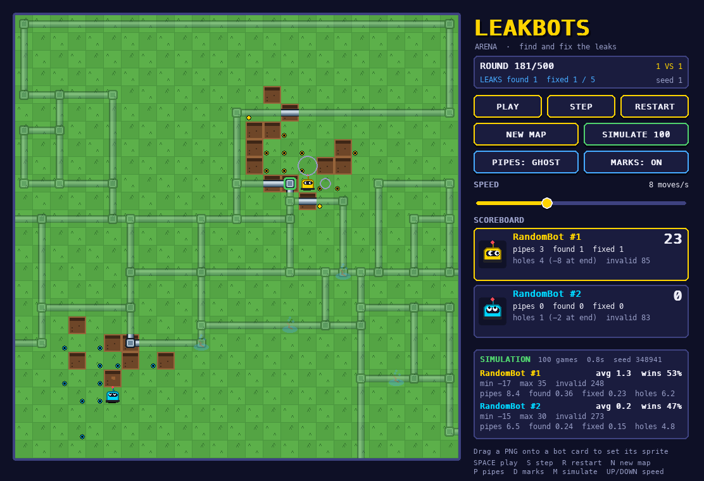

# LeakBots Arena

Program an autonomous bot that hunts for buried water leaks. Bots share a grid, take turns,
detect and dig up pipes, fix leaks — and refill their holes before the final whistle.



## Quick start

```bash
python3 -m venv .venv
source .venv/bin/activate
pip install -r requirements.txt
python main.py                                   # single player, one RandomBot
python main.py --bots random_bot random_bot      # 1 vs 1
python simulate.py --games 100                   # headless benchmark
pytest                                           # run the test suite
```

Requires Python 3.10+ and `pygame-ce` (installed by `requirements.txt`).

## Rules

**Arena.** A 25x25 grid (configurable). Each cell holds at most one bot or game object.
Bots can never leave the grid.

**Pipes.** A random, continuous pipe network is buried under the grid at the start of every
game. Pipes never dead-end inside the map; they only end where they lead off the map edge.
Five pipe cells are broken (leaking). Bots cannot see buried pipes.

**Turns.** Bots act one at a time in a fixed order, one action per turn. One *round* is every
bot acting once. A game always lasts 500 rounds. In single player your bot acts every turn.

**Actions.** Every action targets the neighbouring cell in a direction (`UP`, `DOWN`, `LEFT`,
`RIGHT`), so bots can never dig or fix the cell they are standing on.

| Action    | Valid when the target cell is…              | Effect                                                    |
|-----------|---------------------------------------------|-----------------------------------------------------------|
| `move`    | inside the grid, untouched, free            | the bot moves there                                       |
| `detect`  | inside the grid                             | the bot privately learns whether a pipe is buried there   |
| `unearth` | untouched and free                          | the cell becomes a hole; holes cannot be walked on        |
| `fix`     | an unearthed **broken** pipe                | the pipe becomes fixed                                    |
| `refill`  | any hole, except a still-leaking pipe       | the cell becomes untouched (walkable) again               |

An invalid action (blocked, outside the grid, bad target, or the bot crashed) wastes the turn
and counts as an *invalid move*.

**What bots see.** The whole public map at any time: which cells are untouched or unearthed,
whether an unearthed cell has a pipe, which way it runs, and whether it is OK, broken or
fixed. Detect results are private to the bot that detected them. Bots are **not** told who dug
a hole — track your own digs.

**Scoring.**

| Event                                                         | Points |
|---------------------------------------------------------------|-------:|
| Detect an untouched pipe cell (once per cell per bot)         |     +1 |
| Find a leak (unearth a broken pipe, once per leak)            |     +5 |
| Fix a leak                                                    |    +15 |
| Game end: each pipe hole you dug that is still open           |     −2 |

Ranking: highest score, then fewer invalid moves, then whoever reached their score earliest.

**Coming later:** a *UT upgrade* that lets `detect` also report leaks (already wired in as
`GameConfig.ut_upgrade`), game objects, and more actions.

## Controls

| Button / key          | Does                                                             |
|-----------------------|------------------------------------------------------------------|
| PLAY / `Space`        | play or pause live turns                                         |
| STEP / `S`            | advance a single turn                                            |
| RESTART / `R`         | replay the same map (same seed)                                  |
| NEW MAP / `N`         | roll a new random map                                            |
| SIMULATE 100 / `M`    | play 100 headless games with the current bots, show statistics  |
| PIPES / `P`           | game-master toggle: buried pipes hidden or faintly visible       |
| MARKS / `D`           | show each bot's private detect results as dots                   |
| Speed slider / `↑ ↓`  | 1 – 500 moves per second, far right = MAX                        |

**Custom sprite:** drag a `.png` onto a bot's scoreboard card. It is saved as
`bots/sprites/<ClassName>.png` and used from then on.

## Write a bot

1. Copy `bots/template_bot.py` to `bots/<your_name>_bot.py` and rename the class.
2. Implement `act(self, view) -> Action`.
3. Run it: `python main.py --bots <your_name>_bot:YourBot`
4. Benchmark it: `python simulate.py --bots <your_name>_bot:YourBot --games 200 --seed 1`

```python
from leakbots import Action, BaseBot, BotView, Dir

class DigBot(BaseBot):
    name = "DigBot"

    def act(self, view: BotView) -> Action:
        for d in Dir:
            target = view.neighbor(d)
            if view.in_bounds(target) and target not in view.detected:
                return Action.detect(d)          # scan every neighbour once
        return Action.move(self.rng.choice(list(Dir)))
```

Key parts of the `view` (full list in [leakbots/bot_api.py](leakbots/bot_api.py)):

| Member                          | Meaning                                                        |
|---------------------------------|----------------------------------------------------------------|
| `view.me`                       | your position `(x, y)`; `y` grows downward                     |
| `view.width`, `view.height`     | grid size                                                      |
| `view.round`, `view.rounds_left`| time                                                           |
| `view.cell(pos)`                | `CellInfo(surface, has_pipe, pipe_state, pipe_dirs, bot)`      |
| `view.is_walkable(pos)`         | inside, untouched and free                                     |
| `view.neighbor(d, pos=None)`    | the position next to you (or `pos`) in direction `d`           |
| `view.detected`                 | your private detect memory `{pos: had_pipe}`                   |
| `view.last_result`              | outcome of your previous action (`success`, `message`, `points`) |
| `view.score`, `view.scores`     | your score / everyone's score                                  |
| `self.rng`                      | seeded `random.Random` — use it so games are reproducible      |

Fair play: only use the public members of `view` (nothing starting with `_`).

## Project layout

```
main.py              GUI entry point
simulate.py          headless benchmark CLI
leakbots/            engine (pure Python, no pygame) + gui/ (pygame viewer)
  config.py          GameConfig: grid size, leaks, rounds, point values
  pipes.py           random pipe network generator
  game.py            rules, turn order, scoring
  bot_api.py         BaseBot, BotView, CellInfo, ActionResult
  simulation.py      run many games, aggregate statistics
bots/                competitor bots + sprites/
tests/               pytest suite (rules, pipes, simulation, headless GUI)
```
